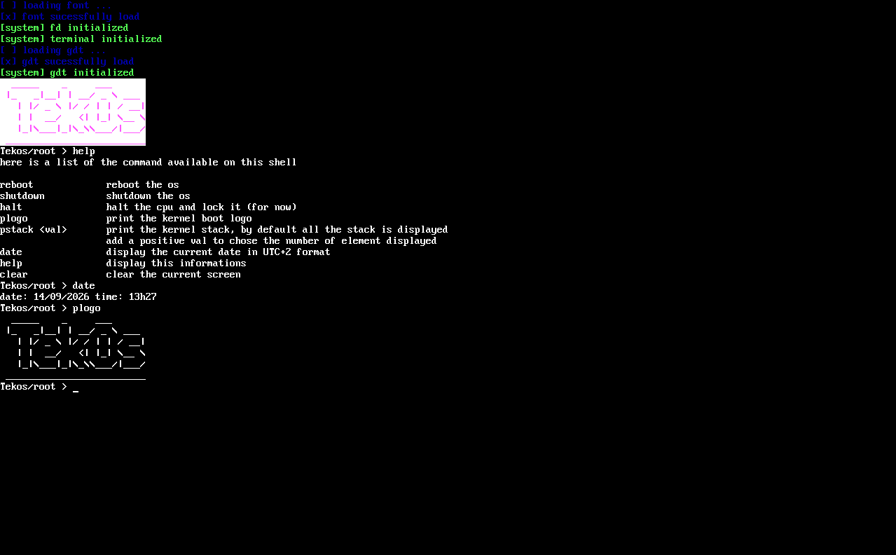

# kfs

> A 32-bit x86 kernel built from scratch.


`kfs` (Kernel From Scratch) is a custom x86 kernel project written as part of
42's systems programming curriculum. The goal is about building each subsystem
(GDT, framebuffer, drivers, memory management, ...) of a kernel, part by part.

<p align="center">
  
</p>

## Project structure

```
kernel/
├── arch/         # architecture-specific code (x86)
├── core/         # architecture-independent kernel code
├── drivers/      # specific drivers file
├── fs/           # file/virtual system
├── include/      # header declarations
├── ressources/   # font file and other
└── syscall       # syscall implementation
libc/
├── include/     # public headers / libc-like reimplementation
└── **/          # implementation matching the headers above
docs/            # technical & developer documentation
grub.cfg         # GRUB boot configuration
```

## Features

**Boot & architecture**
- Boots via GRUB using a Multiboot-compliant kernel
- Meaty Skeleton architecture (see [OSDev](https://wiki.osdev.org/Meaty_Skeleton))
- GDT implementation with ring 0 / ring 3 segments

**Display**
- Text output through VGA text mode or a linear framebuffer, depending on
  what GRUB provides
- Double-buffered rendering
- PSF1/PSF2 font support

**Input & terminal**
- Keyboard driver (currently polling)
- Up to 10 virtual terminals (configurable at compilation -DMAX_SCREENS=), switch with F1-F10,
  exit with Escape
- Small tty and keybinds (escape, arrows, Page Up/Down, Home/End,
  Ctrl+A, Ctrl+L)
- Basic shell with utility and debug functions (reboot, halt, pstack, help ...)

**Core libc**

Currently the libc reimplementation serve has the kernel library, because it does not have a userland for now (that's planned). When the time come, the kernel will build the libc (let's say libk) for him with specials flags, and the user will have the normal one.

- Reimplementation of common standard libc header: `ctype`, `stdio`, `stdlib`, `string`, `unistd`, `stdarg`, `stdint`, `stddef`
- An almost complete reimplementation of `printf` family from scratch, including, buffering, flags, precision, length modifier, bit-exact IEEE 754 float formatting
- Most functions are validated against host libc (see `tests/`)

## Requirements
- An i386 cross-compiler toolchain, see [`docs/toolchain.md`](docs/toolchain.md)
- `gcc` v15+
- `nasm`
- `lld` or `ld` (with `elf_i386` support, see [`docs/toolchain.md`](docs/toolchain.md))
- `grub-mkrescue` and `grub-file`
- `qemu-system-i386`

## Build & run
```sh
make                   # build the kernel binary (bin/kernel)
make help              # display all the available commands
make up                # build the ISO and run it in QEMU
make dev               # run the raw kernel binary directly in QEMU (no ISO)
make debug-up          # build a debug ISO (-DDEBUG=1) and run it in QEMU with serial output
make clean             # remove object files
make fclean            # remove all build artifacts (binaries, ISOs)
make re                # fclean + all
make compile_command   # generate compile_commands.json for clangd (via bear)
```

## Documentation

Detailed technical write-ups (multiboot header, GRUB, memory layout, GDT,
framebuffer, PSF fonts, etc.) live in [`docs/`](./docs/README.md).

A curated list of resources used while building this project (OSDev wiki,
Intel SDM, reference kernels, books) is available in
[`docs/ressources.md`](./docs/ressources.md).

## License

This project is licensed under the GNU General Public License v3.0 - see
[`LICENSE`](./LICENSE).
